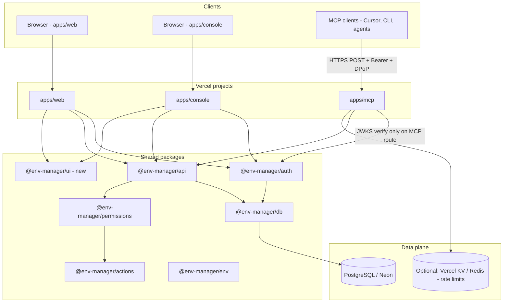

# Plan: `apps/mcp` + `apps/console`

**Status:** Planning only (no implementation in this change).  
**Repo baseline:** pnpm/Turbo monorepo; product app `apps/web`; shared `@env-manager/auth`, `@env-manager/api`, `@env-manager/db`, `@env-manager/actions`, `@env-manager/env`, `@env-manager/notifications`.  
**Related specs:** [`docs/ACTIONS_PERMISSIONS_AUDIT.md`](./ACTIONS_PERMISSIONS_AUDIT.md), [`docs/DESIGN_SYSTEM.md`](./DESIGN_SYSTEM.md).

---

## 1. Goals

| App | Role |
|-----|------|
| **`apps/mcp`** | API-only Next.js deployment hosting a **remote MCP server** (stateless HTTP `POST`, MCP 2026-07-28 profile). OAuth 2.1 protected resource; tools expose org/project/env/variable operations with the same authorization and audit semantics as tRPC. |
| **`apps/console`** | Admin-only Next.js dashboard for **platform operators** (`user.role = admin` + Better Auth **admin** plugin). Cross-tenant visibility: users, orgs, projects, sessions, audit, impersonation/ban, MCP OAuth clients/tokens, feature flags, health. |

Both apps must:

- Share the **same Better Auth instance** (one issuer, one Postgres auth schema, one `BETTER_AUTH_SECRET`).
- Reuse **Drizzle** (`@env-manager/db`), **canonical actions** (`@env-manager/actions`), **`requireAction` / `actionGuard`**, **`audit_event`**, **soft deletes**, and **notifications** where applicable.
- Follow **coss ui / shadcn** conventions from `apps/web` (console only; MCP is API-only).
- Use **`@env-manager/env`** Zod validation for all new env vars.
- Align with existing **tRPC** patterns in `@env-manager/api` (MCP tools call shared service layer, not duplicate business logic).

---

## 2. Current state (relevant facts)

| Area | Today |
|------|--------|
| Auth | `packages/auth` — Better Auth **1.4.x** (catalog `^1.4.9`), GitHub OAuth, `organization` plugin + teams, **no** `admin()`, **no** `jwt()`, **no** MCP/OAuth provider. |
| RBAC | `@env-manager/actions` registry; `requireAction` in `packages/api/src/actions/`; `isPlatformAdmin()` **stub (always false)**. |
| API | tRPC routers: `projects`, `environments`, `environmentVariables`, `organizations`, `projectAccess`, `auditEvents`, `notifications`, `permissions`, `account`, `dashboard`. |
| Audit | `audit_event` when `ACTIONS_AUDIT_ENABLED=true`; legacy `audit_log` still used in some mutation paths. |
| UI | coss ui under `apps/web/src/components/ui/`; not extracted to a package. |
| Deploy | Single Vercel project pattern documented for `apps/web` (`env-manager-web.vercel.app`). |

**Dependency note:** Better Auth **1.7+** documents `@better-auth/mcp`, `@better-auth/cimd`, and `jwt()` as the supported MCP/OAuth 2.1 path. Legacy `mcp` / `oidcProvider` plugins are deprecated (removal in 1.7). This plan assumes a **controlled Better Auth upgrade** (see §8 milestones).

---

## 3. Target architecture



### 3.1 Request paths (logical)

| Surface | Auth mechanism | Authorization |
|---------|----------------|---------------|
| `apps/web` | Session cookie (`/api/auth/*`) | tRPC + `requireAction` / `actionGuard` |
| `apps/console` | Session cookie (SSO) + **platform admin** gate on layout | tRPC `platform.*` procedures + Better Auth admin APIs |
| `apps/mcp` | OAuth 2.1 access token (`Authorization: Bearer`, optional DPoP) | Per-tool `requiredScopes` → mapped canonical action → `requireAction` with `organizationId` / `projectId` from tool args + token `sub` |

### 3.2 Auth issuer placement (recommended default)

- **Authorization server (OAuth + sessions):** hosted on **`apps/web`** at `https://app.<domain>/api/auth` (`BETTER_AUTH_URL` = app origin).
- **MCP resource:** `https://mcp.<domain>/api/mcp` with `mcp({ resource: "https://mcp.<domain>/api/mcp" })` on the **same** Better Auth config (shared `packages/auth`).
- **Console:** `https://console.<domain>` — session cookies via shared parent domain; no separate issuer.

Alternative (open decision): dedicated `auth.<domain>` micro-app; same schema, single `jwt.issuer`.

---

## 4. Better Auth: MCP, OAuth 2.1, and research summary

### 4.1 Official stack (Better Auth 1.7 docs)

| Piece | Purpose |
|-------|---------|
| `jwt()` plugin | Signing keys, `/jwks`, ID/access token format for OAuth provider |
| `mcp()` from `@better-auth/mcp` | OAuth 2.1 AS + RFC 9728 protected resource metadata; **do not** also register standalone `oauthProvider()` |
| `cimd()` from `@better-auth/cimd` | Client ID Metadata Documents — **recommended** for MCP 2026-07-28 (replaces implicit DCR) |
| `@modelcontextprotocol/server` v2 | Stateless MCP handler (`createMcpHandler`, `legacy: "reject"`) |
| `requireMcpAuth(auth, handler, { resource, requiredScopes })` | Verify JWT via JWKS; RFC 9728 `401` / RFC 6750 `403 insufficient_scope` |

**Endpoints (under auth base path):** `/oauth2/authorize`, `/oauth2/token`, `/oauth2/userinfo`; `/oauth2/register` only if DCR explicitly enabled.

**Security advisories (2026):** refresh-token and client-binding issues affected legacy `mcp` / `oidcProvider` plugins — stay on **≥ 1.6.11** (SCIM: ≥ 1.6.22) and use the **new `@better-auth/mcp` package**, not legacy plugins.

### 4.2 Vercel `mcp-handler` / `@vercel/mcp-adapter`

- **`mcp-handler`:** framework-agnostic HTTP adapter for MCP over Next.js route handlers.
- **OAuth:** Vercel documents composing MCP routes with OAuth (changelog: MCP Authorization spec support).
- **Plan:** evaluate `@vercel/mcp-adapter` vs raw `createMcpHandler` + `requireMcpAuth`. Selection criteria: Next.js 16 App Router compatibility, SSE behavior, typing, and whether the adapter duplicates Better Auth’s `requireMcpAuth` (prefer **one** token verification path: Better Auth JWKS).

**Default recommendation:** `createMcpHandler` + `requireMcpAuth` from `@better-auth/mcp` on `apps/mcp/app/api/mcp/route.ts`; use Vercel adapter only if it clearly reduces boilerplate without a second auth stack.

### 4.3 OAuth flows to support

| Flow | Audience |
|------|----------|
| Authorization code + **PKCE** | Standard MCP clients |
| **CIMD** (`metadataProfile: "mcp-2026-07-28"`) | Modern MCP profile |
| **DCR** (opt-in: `allowDynamicClientRegistration`) | Older clients / explicit product requirement |
| **Device authorization** (`oauthDeviceAuthorization`) | First-party CLI only (optional milestone) |
| **Consent** | `consentPage` — UI on web or console (shared component from `@env-manager/ui`) |

### 4.4 Scopes ↔ canonical actions

OAuth scopes are a **coarse, client-facing** grant; canonical actions remain the **fine-grained** server gate (same as tRPC).

**Scope naming:** `<resource>:<verb>` where verb ∈ `read | write | admin` (write implies create/update/delete/restore where applicable).

| OAuth scope | Canonical actions covered (minimum) |
|-------------|-------------------------------------|
| `openid`, `profile`, `offline_access` | OIDC baseline (not action-gated) |
| `organizations:read` | `organization.list`, `organization.view`, `organization.hub.view`, `member.list`, `team.*` read paths |
| `organizations:write` | `organization.create`, `organization.update`, `organization.delete`, `organization.restore`, `member.*`, `invitation.*`, `team.*` mutations |
| `projects:read` | `project.read`, `environment.read`, `variable.read` (not `variable.reveal`) |
| `projects:write` | `project.create`, `project.update`, `project.delete`, `project.restore`, `project.archive`, `project.status.change`, `project.public.toggle`, `project.assign_*`, `project.permission.grant`, env CRUD |
| `variables:read` | `variable.read` |
| `variables:write` | `variable.create`, `variable.update`, `variable.delete`, `variable.restore`, `variable.bulk_import`, `variable.export` |
| `variables:reveal` | `variable.reveal` (separate high-risk scope) |
| `audit:read` | `audit.timeline.view.org`, `audit.timeline.view.project`, `audit.timeline.view.self` |
| `notifications:read` | `notification.list` |
| `notifications:write` | `notification.mark_read` |
| `mcp:tools` | Base MCP invocation (required on route) |
| `platform:admin` | **Console / service accounts only** — `platform.*` actions; never issued to standard MCP user consent |

**Implementation:** `packages/permissions` (or `@env-manager/actions` extension) exports `scopeToActions`, `actionToScopes`, and `mcpToolRequiredScopes(toolName)`.

Per-tool handler:

1. Verify OAuth scopes (Better Auth `requireMcpAuth` or `createInsufficientScopeError` for step-up).
2. Resolve `userId` from token `sub`; resolve `organizationId` / `projectId` from tool input (and validate membership).
3. `await requireAction("<canonical>", { userId, organizationId, projectId, ipAddress, userAgent })`.
4. Execute shared service function (extracted from tRPC routers).
5. `writeAuditEvent` with `source: "mcp"`, `oauthClientId`, `toolName` in metadata (redacted args).

---

## 5. `apps/mcp` (API-only Next.js)

### 5.1 App shape

```
apps/mcp/
  package.json          # name: mcp, depends on @env-manager/*
  next.config.ts        # minimal; no public marketing pages
  src/app/
    api/
      mcp/route.ts      # POST only — MCP + requireMcpAuth
      health/route.ts   # public liveness (no secrets)
    layout.tsx          # bare minimum (or omit pages entirely)
  # Optional: thin routes that proxy OAuth metadata if resource is split-host
```

- **No tRPC HTTP surface** for external clients (MCP only). Internal reuse via `@env-manager/api` service layer imports (see §7).
- **Env:** extend `@env-manager/env` with `apps/mcp` profile (`MCP_RESOURCE_URL`, `MCP_RATE_LIMIT_*`, `BETTER_AUTH_URL` for JWKS, shared DB vars).

### 5.2 Cross-cutting MCP concerns

| Concern | Approach |
|---------|----------|
| **Rate limiting** | Per `oauth_client_id` + per `userId` token bucket (Vercel KV or Postgres `rate_limit_event`); return JSON-RPC error with `429` |
| **Secret redaction** | Never return `encryptedValue` / decrypted secrets unless tool is `variables_reveal` and action `variable.reveal` succeeded; strip from audit metadata via registry `capturePayload` rules |
| **Org/project scoping** | Every mutating tool requires explicit `organizationId` or `organizationSlug` + `projectId` or `projectSlug`; reject cross-org IDs |
| **Soft deletes** | List tools respect `SOFT_DELETES_ENABLED` and active-only filters unless `includeDeleted` + `*.restore` action |
| **Notifications** | Reuse `notify-from-audit` on successful mutations where registry defines `notifyOn` |
| **Idempotency** | Optional `idempotencyKey` on write tools → dedupe table or hash in audit metadata |

### 5.3 MCP tool inventory

Convention: **tool name** `snake_case`; **canonical action** from `@env-manager/actions`; **OAuth scopes** minimum set (client may hold superset).

#### Organizations

| Tool | Type | Canonical action | OAuth scopes |
|------|------|------------------|--------------|
| `organizations_list` | read | `organization.list` | `organizations:read` |
| `organizations_get` | read | `organization.view` | `organizations:read` |
| `organizations_create` | write | `organization.create` | `organizations:write` |
| `organizations_update` | write | `organization.update` | `organizations:write` |
| `organizations_delete` | write | `organization.delete` | `organizations:write` |
| `organizations_restore` | write | `organization.restore` | `organizations:write` |

#### Members

| Tool | Type | Canonical action | OAuth scopes |
|------|------|------------------|--------------|
| `members_list` | read | `member.list` | `organizations:read` |
| `members_invite` | write | `member.invite` | `organizations:write` |
| `members_remove` | write | `member.remove` | `organizations:write` |
| `members_update_role` | write | `member.role.update` | `organizations:write` |

#### Teams

| Tool | Type | Canonical action | OAuth scopes |
|------|------|------------------|--------------|
| `teams_list` | read | `member.list` + team query (org hub) | `organizations:read` |
| `teams_create` | write | `team.create` | `organizations:write` |
| `teams_update` | write | `team.update` | `organizations:write` |
| `teams_delete` | write | `team.delete` | `organizations:write` |
| `teams_restore` | write | `team.restore` | `organizations:write` |
| `teams_add_member` | write | `team.member.add` | `organizations:write` |
| `teams_remove_member` | write | `team.member.remove` | `organizations:write` |

#### Invitations

| Tool | Type | Canonical action | OAuth scopes |
|------|------|------------------|--------------|
| `invitations_list` | read | `member.list` (pending invites) | `organizations:read` |
| `invitations_accept` | write | `invitation.accept` | `organizations:write` |
| `invitations_reject` | write | `invitation.reject` | `organizations:write` |
| `invitations_cancel` | write | `invitation.cancel` | `organizations:write` |

#### Projects

| Tool | Type | Canonical action | OAuth scopes |
|------|------|------------------|--------------|
| `projects_list` | read | `project.read` (list) | `projects:read` |
| `projects_get` | read | `project.read` | `projects:read` |
| `projects_get_by_slug` | read | `project.read` | `projects:read` |
| `projects_create` | write | `project.create` | `projects:write` |
| `projects_update` | write | `project.update` | `projects:write` |
| `projects_delete` | write | `project.delete` | `projects:write` |
| `projects_restore` | write | `project.restore` | `projects:write` |
| `projects_archive` | write | `project.archive` | `projects:write` |
| `projects_unarchive` | write | `project.archive` (unarchive maps to archive action or add `project.unarchive` to registry) | `projects:write` |
| `projects_change_status` | write | `project.status.change` | `projects:write` |
| `projects_toggle_public` | write | `project.public.toggle` | `projects:write` |
| `projects_assign_manager` | write | `project.assign_manager` | `projects:write` |
| `projects_assign_team` | write | `project.assign_team` | `projects:write` |
| `projects_set_member_grants` | write | `project.permission.grant` | `projects:write` |
| `projects_list_managers` | read | `project.read` | `projects:read` |

> **Registry gap:** `project.unarchive` is not a separate action today; either add `project.unarchive` to the registry or map unarchive to `project.archive` with direction in tool metadata (prefer **new canonical** `project.unarchive` in migration approval bundle).

#### Environments

| Tool | Type | Canonical action | OAuth scopes |
|------|------|------------------|--------------|
| `environments_list` | read | `environment.read` | `projects:read` |
| `environments_get` | read | `environment.read` | `projects:read` |
| `environments_create` | write | `environment.create` | `projects:write` |
| `environments_update` | write | `environment.update` | `projects:write` |
| `environments_delete` | write | `environment.delete` | `projects:write` |
| `environments_restore` | write | `environment.restore` | `projects:write` |

#### Variables

| Tool | Type | Canonical action | OAuth scopes |
|------|------|------------------|--------------|
| `variables_list` | read | `variable.read` | `variables:read` |
| `variables_counts_by_environment` | read | `variable.read` | `variables:read` |
| `variables_get` | read | `variable.read` (metadata only) | `variables:read` |
| `variables_create` | write | `variable.create` | `variables:write` |
| `variables_create_batch` | write | `variable.create` | `variables:write` |
| `variables_update` | write | `variable.update` | `variables:write` |
| `variables_delete` | write | `variable.delete` | `variables:write` |
| `variables_restore` | write | `variable.restore` | `variables:write` |
| `variables_reveal` | read | `variable.reveal` | `variables:reveal` |
| `variables_bulk_import` | write | `variable.bulk_import` | `variables:write` |
| `variables_export` | read | `variable.export` | `variables:write` |

#### Audit

| Tool | Type | Canonical action | OAuth scopes |
|------|------|------------------|--------------|
| `audit_events_list` | read | `audit.timeline.view.org` or `.project` or `.self` (by filter) | `audit:read` |
| `audit_timeline_org` | read | `audit.timeline.view.org` | `audit:read` |
| `audit_timeline_project` | read | `audit.timeline.view.project` | `audit:read` |
| `audit_timeline_user` | read | `audit.timeline.view.user` | `audit:read` |

#### Notifications

| Tool | Type | Canonical action | OAuth scopes |
|------|------|------------------|--------------|
| `notifications_list` | read | `notification.list` | `notifications:read` |
| `notifications_unread_count` | read | `notification.list` | `notifications:read` |
| `notifications_mark_read` | write | `notification.mark_read` | `notifications:write` |
| `notifications_mark_all_read` | write | `notification.mark_read` | `notifications:write` |

#### Permissions (read-only helper)

| Tool | Type | Canonical action | OAuth scopes |
|------|------|------------------|--------------|
| `permissions_snapshot` | read | `project.read` or org hub view | `organizations:read` + `projects:read` |

**Total:** 58 MCP tools (including helpers). Console-only platform tools are **not** exposed via MCP.

---

## 6. `apps/console` (platform admin UI)

### 6.1 Access model

- Enable Better Auth **`admin()`** plugin on shared auth config (after migration adds `user.role`).
- `isPlatformAdmin(user)` → `user.role === "admin"` (and plugin validation).
- Next.js **middleware** on `apps/console`: require session + platform admin; else redirect to `apps/web` sign-in with `?error=platform_forbidden`.
- All console mutations use canonical **`platform.*`** actions (already reserved in registry): `platform.user.list`, `platform.user.set_role`, `platform.user.impersonate`, etc.

### 6.2 Feature modules (routes)

| Module | Data source | Notes |
|--------|-------------|-------|
| **Users** | admin plugin + Drizzle | Search, role, ban, sessions revoke |
| **Organizations** | cross-tenant SQL | Read-only + support actions (restore org) via platform actions |
| **Projects** | cross-tenant | Read-only default; destructive ops behind explicit platform action + audit |
| **Sessions** | `session` table | List/revoke any session |
| **Audit** | `audit_event` | Global timeline filters; export |
| **Impersonation** | admin plugin | Banner in web when impersonating; short TTL |
| **MCP OAuth** | `oauthClient`, `oauthAccessToken`, `oauthRefreshToken`, `oauthConsent` | Revoke tokens, disable clients, view scopes |
| **Feature flags** | `platform_feature_flag` (new) or env-backed | Toggle `ORGANIZATIONS_ENABLED`, etc., with audit |
| **System health** | `healthCheck`, DB latency, migration version, queue depth | No secrets in UI |

### 6.3 UI kit

- Depend on `@env-manager/ui` (extracted from web): same `components.json` / `@coss/*` tokens, `ToastProvider`, data-table primitives.
- Console branding: distinct sidebar header (“Platform Console”), read-only badges for production.

### 6.4 API surface

- **Option A (recommended):** `apps/console/app/api/trpc/[trpc]/route.ts` mounting `consoleRouter` merged or separate from `appRouter` (`platform` namespace).
- **Option B:** Server Actions only — **not** recommended (breaks parity with web tRPC patterns).

---

## 7. Shared package extraction plan

| Package | Extract from | Contents |
|---------|--------------|----------|
| **`@env-manager/auth`** (extend existing) | `packages/auth` | `createAuth(options)` factory: `plugins: [jwt, mcp, cimd, organization, admin]` toggled by env; shared `trustedOrigins`; export handlers for each app. |
| **`@env-manager/permissions`** (new) | `packages/api/src/actions/*` | `requireAction`, `actionGuard`, `isActionBlocked`, `evaluatePermission`, MCP `assertMcpToolAuthorized(tool, claims, ctx)`; **no** tRPC dependency (inject `db` via context). |
| **`@env-manager/ui`** (new) | `apps/web/src/components/ui`, `lib/toast.ts`, `lib/icons.ts` | Presentational components only; peer deps: `react`, `next`, tailwind. |
| **`@env-manager/api`** (extend) | routers | `services/*` pure functions called by tRPC **and** MCP tools; routers become thin. |

**Turbo:** add `apps/mcp` and `apps/console` to `pnpm-workspace`; `build` env vars in `turbo.json` for new flags.

**Order of extraction:** permissions → api services → ui (can parallel console shell with duplicated imports short-term if needed).

---

## 8. Schema changes (single combined migration — **requires user approval**)

Proposed file: **`packages/db/src/migrations/0008_mcp_console_platform.sql`** (and Drizzle schema sync). Do **not** apply in planning phase.

### 8.1 Better Auth OAuth / MCP (from plugin schema)

Tables (names per Better Auth OAuth provider docs):

- `oauth_client`
- `oauth_access_token`
- `oauth_refresh_token`
- `oauth_consent`
- `oauth_client_assertion`

Generate via `npx @better-auth/cli migrate` after plugin config is codified; fold into **one** approved SQL bundle.

### 8.2 Platform admin

```sql
ALTER TABLE "user" ADD COLUMN IF NOT EXISTS "role" text NOT NULL DEFAULT 'user';
CREATE INDEX IF NOT EXISTS "user_role_idx" ON "user" ("role");
-- Optional: ban fields from admin plugin if not auto-created
```

### 8.3 Audit extensions

```sql
ALTER TABLE "audit_event" ADD COLUMN IF NOT EXISTS "source" text NOT NULL DEFAULT 'trpc';
ALTER TABLE "audit_event" ADD COLUMN IF NOT EXISTS "oauth_client_id" text;
ALTER TABLE "audit_event" ADD COLUMN IF NOT EXISTS "mcp_tool" text;
CREATE INDEX IF NOT EXISTS "audit_event_source_idx" ON "audit_event" ("source", "created_at");
```

### 8.4 Rate limiting (optional but recommended for MCP)

```sql
CREATE TABLE IF NOT EXISTS "rate_limit_bucket" (
  "key" text PRIMARY KEY,
  "count" integer NOT NULL,
  "window_start" timestamptz NOT NULL
);
```

### 8.5 Feature flags (console)

```sql
CREATE TABLE IF NOT EXISTS "platform_feature_flag" (
  "key" text PRIMARY KEY,
  "enabled" boolean NOT NULL DEFAULT false,
  "updated_at" timestamptz NOT NULL DEFAULT now(),
  "updated_by" text REFERENCES "user"("id") ON DELETE SET NULL
);
```

### 8.6 Registry additions

- Add `project.unarchive` (and any `platform.oauth.*` audit actions) to `@env-manager/actions` in the same release train as migration.

---

## 9. Security model

| Layer | Control |
|-------|---------|
| **Transport** | TLS only; HSTS on all three apps |
| **Session (web/console)** | HttpOnly, Secure, SameSite=Lax; `__Secure-` prefix in production; rotate on privilege change |
| **MCP tokens** | Short-lived access tokens; refresh rotation; DPoP when bound; PKCE on code flow |
| **Consent** | Show requested scopes + org context; record `oauth_consent` |
| **Authorization** | OAuth scopes ⊆ token; **every** tool calls `requireAction` (fail closed) |
| **ADMIN** | Never via MCP user tokens; console IP allowlist optional |
| **Secrets** | `variable.reveal` isolated scope; audit severity `security`; redact in logs |
| **CSRF** | MCP POST JSON-RPC — no cookies; web/console keep Better Auth defaults |
| **CORS** | `apps/mcp` minimal; auth CORS `trustedOrigins` lists web + console + mcp |
| **Impersonation** | Watermark + `audit_event` `platform.user.impersonate` |
| **Dependency** | Pin Better Auth ≥ 1.7.x after security review |

---

## 10. SSO across web, console, and MCP

### 10.1 Browser SSO (web ↔ console)

| Mechanism | Configuration |
|-----------|---------------|
| **Shared parent cookie domain** | `BETTER_AUTH_COOKIE_DOMAIN=.env-manager.com` (or product domain) |
| **Issuer** | Single `BETTER_AUTH_URL` pointing at web app auth routes |
| **trustedOrigins** | `https://app.*`, `https://console.*`, local dev ports |
| **Active org** | Console may ignore active org or use a dedicated “platform” context |

### 10.2 MCP (machine clients)

- No shared cookies; OAuth code + PKCE (+ CIMD client id).
- Resource metadata at `https://mcp.<domain>/.well-known/oauth-protected-resource` (served by auth/MCP plugin).
- Access token `aud` = MCP resource URL.

### 10.3 Local development

| App | Port (suggested) |
|-----|------------------|
| web | 3000 |
| console | 3001 |
| mcp | 3002 |

Use `*.localhost` or env-specific `BETTER_AUTH_URL` per app with shared DB; document limitation that cookie SSO may not work across ports (use separate sign-ins locally).

---

## 11. Vercel project setup

| Vercel project | Root directory | Domain (example) | Key env vars |
|----------------|----------------|------------------|--------------|
| `env-manager-web` | `apps/web` | `app.env-manager.com` | Existing + `BETTER_AUTH_COOKIE_DOMAIN`, OAuth plugin secrets |
| `env-manager-console` | `apps/console` | `console.env-manager.com` | Same DB/auth secrets, `CONSOLE_ENABLED=true` |
| `env-manager-mcp` | `apps/mcp` | `mcp.env-manager.com` | `MCP_RESOURCE_URL`, JWKS URL → web auth, rate limit KV |

**Monorepo settings:** enable **Root Directory** per project; shared `turbo build` with filter (`turbo build --filter=mcp`).  
**Preview deployments:** console/mcp previews use branch URLs; add each to `trustedOrigins` via wildcard policy (open decision).

**GitHub integration:** one repo; three Vercel projects; production branch `main`.

---

## 12. Environment variables (new / shared)

Extend `@env-manager/env/server.ts` (and `web.ts` where needed):

| Variable | Apps | Purpose |
|----------|------|---------|
| `BETTER_AUTH_COOKIE_DOMAIN` | web, console | SSO cookie scope |
| `MCP_RESOURCE_URL` | mcp, auth | RFC 9728 resource identifier |
| `MCP_ENABLED` | mcp, auth | Gate MCP plugin |
| `CONSOLE_ENABLED` | console | Gate console deploy |
| `PLATFORM_ADMIN_EMAILS` | auth (bootstrap) | Seed first admins (optional) |
| `OAUTH_DCR_ENABLED` | auth | Dynamic client registration |
| `RATE_LIMIT_KV_URL` | mcp | Vercel KV / Redis |
| `JWT_ISSUER` | auth, mcp | Override if auth split-host |

Existing: `DATABASE_URL`, `BETTER_AUTH_SECRET`, `BETTER_AUTH_URL`, `CORS_ORIGIN`, `ENCRYPTION_KEY`, feature flags (`ACTIONS_AUDIT_ENABLED`, etc.).

---

## 13. Phased milestones and acceptance criteria

### Phase 0 — Planning sign-off (this document)

- [ ] User approves open decisions (§15).
- [ ] User approves combined migration `0008` scope (§8).

### Phase 1 — Platform foundation

- Upgrade Better Auth to 1.7.x; add `jwt()`, `user.role`, `admin()` stub wired to `isPlatformAdmin()`.
- Extract `@env-manager/permissions`; retrofit `packages/api` imports.
- **Acceptance:** unit tests for `evaluatePermission`; `isPlatformAdmin()` true only for `role=admin`; web unchanged for non-admins.

### Phase 2 — `apps/console` shell

- Create app with SSO cookie domain; middleware gate; users list read-only.
- `consoleRouter` with `platform.user.list`.
- **Acceptance:** non-admin cannot load console; admin sees users; actions audited.

### Phase 3 — OAuth + MCP auth

- Add `mcp()`, `cimd()`, consent/sign-in pages (shared UI); migration `0008` applied to staging.
- `apps/mcp` exposes `POST /api/mcp` with `echo` tool only.
- **Acceptance:** MCP client completes PKCE flow; token verifies against JWKS; echo tool audited.

### Phase 4 — MCP tool parity (read)

- Implement read tools (orgs, projects, envs, variables metadata, audit, notifications).
- **Acceptance:** integration test with scoped token; denied without scope; `requireAction` denial → audit `denied`.

### Phase 5 — MCP tool parity (write)

- Write tools + secret redaction + rate limits.
- **Acceptance:** variable write without `variables:reveal` never returns plaintext; rate limit returns 429.

### Phase 6 — Console complete

- Impersonation, ban, OAuth client admin, feature flags, health.
- **Acceptance:** impersonation visible in web; revoke MCP token blocks next tool call.

### Phase 7 — Hardening & GA

- Load test MCP; security review; document runbooks.
- **Acceptance:** pen test checklist; on-call runbook in `docs/`.

---

## 14. Risks

| Risk | Impact | Mitigation |
|------|--------|------------|
| Better Auth upgrade breaks sessions | High | Staged rollout; e2e auth suite; backup sessions table |
| Legacy MCP clients need DCR | Medium | Explicit `OAUTH_DCR_ENABLED`; document CIMD-first |
| Duplicated business logic in MCP vs tRPC | High | Service layer extraction mandatory before write tools |
| Cross-tenant data leak in console | Critical | Separate router; SQL always parameterized; platform action on every query |
| Token scope too coarse | Medium | Step-up via `insufficient_scope`; split `variables:reveal` |
| Rate limit bypass | Medium | KV + per-user limits; alert on anomaly |
| Cookie SSO misconfiguration | Medium | Document `BETTER_AUTH_COOKIE_DOMAIN`; e2e console SSO test |
| Advisory history on OAuth plugins | High | Stay on patched 1.7+; use `@better-auth/mcp` only |

---

## 15. Open decisions (user input required)

1. **Product domain layout:** use `app.`, `console.`, `mcp.` subdomains on the production apex, or keep `env-manager-web.vercel.app` until custom DNS?
2. **Auth host:** single issuer on `apps/web` vs dedicated `auth.` subdomain app?
3. **MCP client identity:** **CIMD-only** (Better Auth recommended) vs also enable **DCR** for backward compatibility?
4. **Consent UI location:** host consent on `apps/web`, `apps/console`, or minimal pages on `apps/mcp`?
5. **Unarchive mapping:** add canonical `project.unarchive` to the registry, or overload `project.archive`?
6. **Rate limiting backend:** Vercel KV, Postgres buckets, or Upstash Redis?
7. **Console feature flags:** DB table (`platform_feature_flag`) vs continue env-only toggles with console UI read-only?
8. **MCP transport library:** raw `@modelcontextprotocol/server` + `requireMcpAuth` vs `@vercel/mcp-adapter`?
9. **Service account tokens:** allow non-user `sub` (machine users) for automation, or human-only OAuth?
10. **Preview / staging OAuth:** wildcard `trustedOrigins` for `*.vercel.app` or explicit per-preview registration?
11. **IP allowlist for console:** required in production or optional?
12. **Device authorization flow:** ship in v1 for a first-party CLI, or defer?
13. **Cross-org MCP tools:** should `organizations_list` return all memberships (default) or require `organizationId` on every call?
14. **Audit retention:** same as web or shorter for high-volume MCP `success` events?
15. **Better Auth upgrade timing:** upgrade before any new app, or ship console shell on 1.4.x then jump?

---

## 16. References

- [Better Auth — MCP plugin](https://www.better-auth.com/docs/plugins/mcp)
- [Better Auth — OAuth 2.1 Provider](https://www.better-auth.com/docs/plugins/oauth-provider)
- [Better Auth — Admin plugin](https://www.better-auth.com/docs/plugins/admin)
- [Better Auth — CIMD](https://www.better-auth.com/docs/plugins/cimd)
- [Vercel — MCP](https://vercel.com/docs/mcp)
- [Vercel — Deploy MCP servers](https://vercel.com/docs/mcp/deploy-mcp-servers-to-vercel)
- [mcp-handler (GitHub)](https://github.com/vercel-labs/mcp-handler)
- Internal: [`docs/ACTIONS_PERMISSIONS_AUDIT.md`](./ACTIONS_PERMISSIONS_AUDIT.md)

---

*Document version: 1.0 — planning commit to `main`.*
