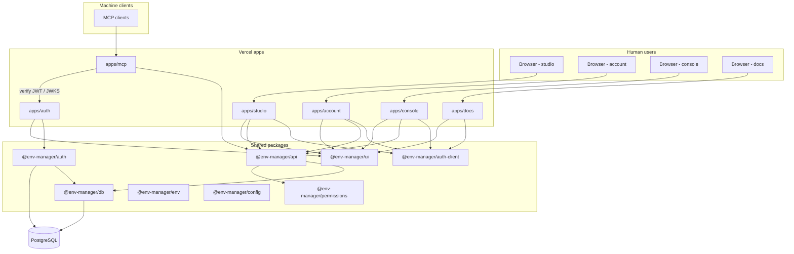
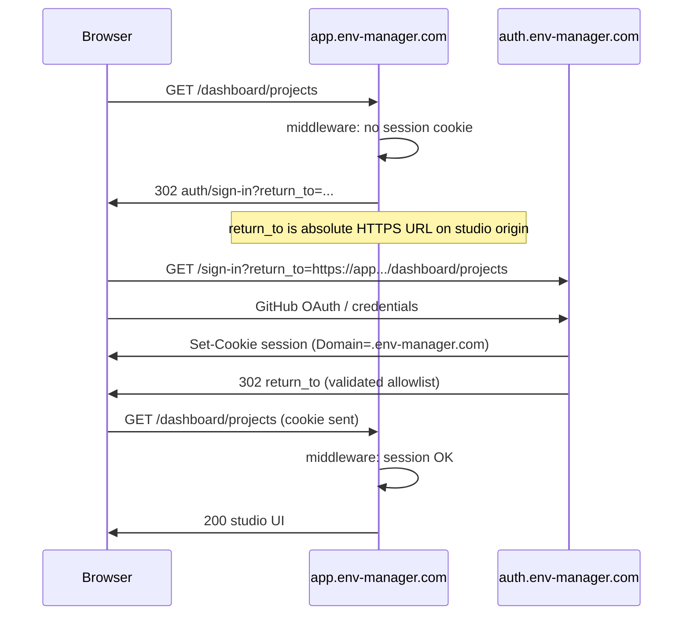
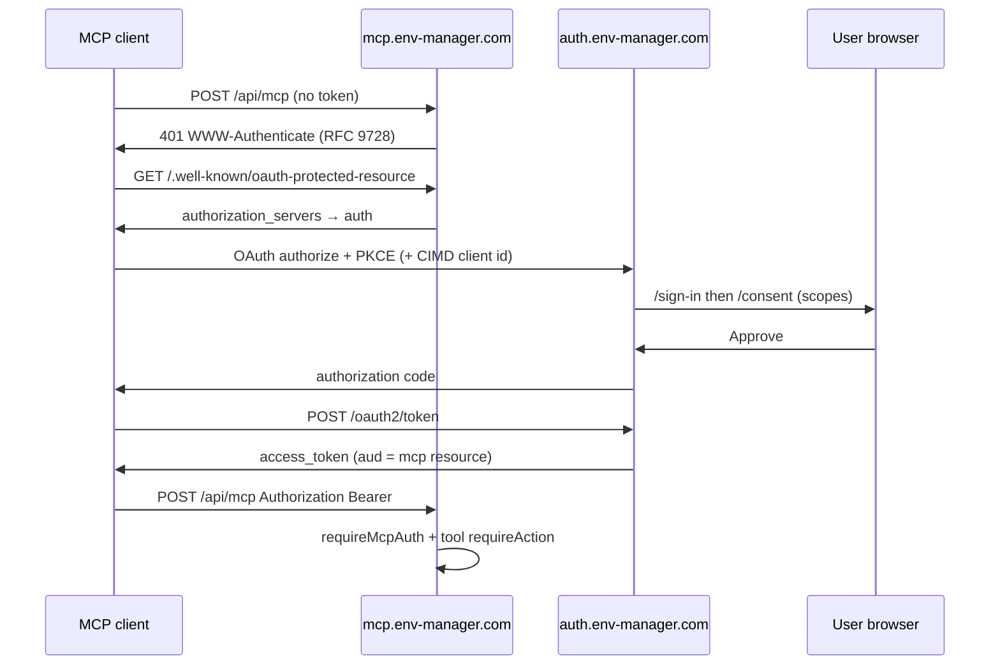

# Plan: Platform apps (auth, account, studio, console, mcp, docs)

**Status:** Planning only (no implementation).  
**Supersedes:** [`docs/PLAN_MCP_AND_CONSOLE.md`](./PLAN_MCP_AND_CONSOLE.md) (MCP + console scope is folded in here).  
**Baseline:** Monorepo today with product app **`apps/web`** (orgs/projects/envs/variables, account settings under `/dashboard/settings`, sign-in at `/sign-in`, auth at `/api/auth/*` on the same host).  
**Related:** [`docs/ACTIONS_PERMISSIONS_AUDIT.md`](./ACTIONS_PERMISSIONS_AUDIT.md), [`docs/DESIGN_SYSTEM.md`](./DESIGN_SYSTEM.md).

---

## 1. Target app map

| App | Purpose | UI | Auth surface |
|-----|---------|-----|--------------|
| **`apps/auth`** | Single entry for **sign-in / sign-up / sign-out** for all products; **OAuth 2.1 authorization server**; **MCP authorization** (login + consent for MCP clients). Hosts Better Auth route handler only (+ minimal auth/consent/device pages). | coss ui (minimal) | **Issuer** — `BETTER_AUTH_URL` = auth origin |
| **`apps/account`** | **Account management** moved out of studio: profile, sessions, connected accounts, export, delete, personal audit timeline. | coss ui | Session cookie (SSO) |
| **`apps/studio`** | **Main product** — rename/migrate from `apps/web`: orgs, projects, environments, variables, org hub, notifications, onboarding. **No** account settings (link out to account). | coss ui | Session cookie (SSO) |
| **`apps/console`** | **Platform admin** (`user.role = admin` + Better Auth admin plugin): users, orgs, projects, sessions, global audit, impersonation/ban, MCP OAuth clients/tokens, feature flags, health. | coss ui | Session cookie (SSO) + admin gate |
| **`apps/mcp`** | **API-only** remote MCP server (stateless HTTP `POST`, MCP 2026-07-28). | none | OAuth access token (+ optional DPoP) |
| **`apps/docs`** | Product + MCP documentation (**Fumadocs** content/MDX pipeline) with **our** chrome (`@env-manager/ui`), not Fumadocs default theme. | coss ui shell + Fumadocs primitives | Public read; optional “edit on GitHub”; sign-in links to auth |

**Invariant:** One Postgres database, one `@env-manager/auth` server config instantiated **only** on `apps/auth` (other apps use `@env-manager/auth-client` + session validation / tRPC context).

---

## 2. Domains and subdomains (production)

Example apex: **`env-manager.com`** (or current Vercel custom domain). Each app = **one Vercel project** with its own root directory.

| App | Subdomain | `BETTER_AUTH_URL` (auth app only) | Public role |
|-----|-----------|-----------------------------------|-------------|
| auth | `https://auth.env-manager.com` | **self** | Login, OAuth `/oauth2/*`, well-known |
| account | `https://account.env-manager.com` | points to auth | Account settings |
| studio | `https://app.env-manager.com` | points to auth | Product (replaces `env-manager-web.vercel.app`) |
| console | `https://console.env-manager.com` | points to auth | Platform admin |
| mcp | `https://mcp.env-manager.com` | JWKS/issuer → auth | MCP `POST /api/mcp` |
| docs | `https://docs.env-manager.com` | points to auth (for “signed in” nav only) | Documentation |

**Marketing / www:** optional `https://env-manager.com` → docs or studio (open decision).

**GitHub OAuth callback:** `https://auth.env-manager.com/api/auth/callback/github` (single callback after cutover).

### 2.1 Local development

| App | Port | Host hint |
|-----|------|-----------|
| auth | 3000 | `auth.localhost` or `localhost:3000` |
| studio | 3001 | `app.localhost` |
| account | 3002 | `account.localhost` |
| console | 3003 | `console.localhost` |
| mcp | 3004 | `mcp.localhost` |
| docs | 3005 | `docs.localhost` |

Cross-port cookie SSO is unreliable; prefer **shared parent** `*.localhost` + `crossSubDomainCookies` or auth proxy rewrites per app (see §5).

---

## 3. Architecture



---

## 4. Better Auth — official building blocks (cited)

Implement **`apps/auth`** strictly from current Better Auth docs (target **≥ 1.7.x** after upgrade from catalog 1.4.x).

| Concern | Doc | Usage on `apps/auth` |
|---------|-----|----------------------|
| Core server + database | [Database](https://www.better-auth.com/docs/concepts/database) | Drizzle adapter, shared schema |
| Sessions + cookies | [Sessions](https://www.better-auth.com/docs/concepts/session-management), [Cookies](https://www.better-auth.com/docs/concepts/cookies) | `crossSubDomainCookies`, `trustedOrigins` |
| Browser client | [Client](https://www.better-auth.com/docs/concepts/client) | Re-exported from `@env-manager/auth-client` |
| OAuth for MCP | [MCP plugin](https://www.better-auth.com/docs/plugins/mcp) | `mcp({ loginPage, consentPage, resource })` — **is** the OAuth 2.1 provider; do **not** add separate `oauthProvider()` |
| OAuth 2.1 details | [OAuth 2.1 Provider](https://www.better-auth.com/docs/plugins/oauth-provider) | Schema: `oauthClient`, tokens, consent |
| MCP client identity | [CIMD](https://www.better-auth.com/docs/plugins/cimd) | `cimd({ metadataProfile: "mcp-2026-07-28" })` |
| JWT / JWKS | [JWT plugin](https://www.better-auth.com/docs/plugins/jwt) | Required for MCP/OAuth tokens |
| Orgs (product) | [Organization](https://www.better-auth.com/docs/plugins/organization) | Keep on shared auth config (studio uses org APIs via session) |
| Platform admin | [Admin](https://www.better-auth.com/docs/plugins/admin) | Console only consumers; enabled on same auth instance |
| Optional CLI | [Device Authorization](https://www.better-auth.com/docs/plugins/device-authorization) | First-party CLI → `/device` on auth |
| Enterprise SSO (future) | [SSO plugin](https://www.better-auth.com/docs/plugins/sso) | SAML/OIDC **IdP** into auth — not required for v1 |
| Legacy | Avoid deprecated in-repo `oidcProvider` / old `mcp` plugin — use **`@better-auth/mcp`** per [MCP plugin](https://www.better-auth.com/docs/plugins/mcp) |

**MCP resource URL:** `mcp({ resource: "https://mcp.env-manager.com/api/mcp" })` on auth; `apps/mcp` protects route with `requireMcpAuth` / `createMcpProtectedRequestHandler` ([MCP plugin — Protecting an MCP Route](https://www.better-auth.com/docs/plugins/mcp#protecting-an-mcp-route)).

**Vercel MCP hosting:** [Deploy MCP servers](https://vercel.com/docs/mcp/deploy-mcp-servers-to-vercel), [mcp-handler](https://github.com/vercel-labs/mcp-handler) — evaluate vs official SDK + `requireMcpAuth`.

---

## 5. SSO: session sharing and return-to

### 5.1 Recommended: shared parent domain + cross-subdomain cookies

Per [Cross Subdomain Cookies](https://www.better-auth.com/docs/concepts/cookies#cross-subdomain-cookies):

```ts
// packages/auth — used only by apps/auth
advanced: {
  crossSubDomainCookies: {
    enabled: true,
    domain: "env-manager.com", // apex — see open decision on dot-prefix
  },
},
trustedOrigins: [
  "https://auth.env-manager.com",
  "https://app.env-manager.com",
  "https://account.env-manager.com",
  "https://console.env-manager.com",
  "https://docs.env-manager.com",
  // previews: policy TBD
],
```

`BETTER_AUTH_URL` = `https://auth.env-manager.com` (issuer + `/api/auth/*`).

**Sibling apps** do **not** mount `/api/auth/*`; they call `authClient` with `baseURL: process.env.NEXT_PUBLIC_AUTH_URL` and rely on the shared session cookie.

### 5.2 Safari / ITP fallback: per-app auth proxy

If auth and studio ever sit on **unrelated** domains, use [reverse proxy rewrites](https://www.better-auth.com/docs/concepts/cookies#using-a-reverse-proxy) so each app exposes **same-origin** `/api/auth/*` → `auth.env-manager.com`.

```json
// apps/studio/vercel.json (example)
{
  "rewrites": [
    {
      "source": "/api/auth/:path*",
      "destination": "https://auth.env-manager.com/api/auth/:path*"
    }
  ]
}
```

Prefer **one** strategy in prod: either all apps use rewrites **or** all use cross-subdomain cookies — mixing increases bug surface.

### 5.3 Browser SSO flow (studio → auth → studio)



### 5.4 Return-to / redirect contract

**Problem:** Today `apps/web` uses **relative** `redirect` query params (`safeRedirectPath` in `apps/web/src/lib/auth-routes.ts`). Multi-app SSO needs **cross-origin** return URLs.

**Proposed standard (all apps):**

| Param | Where | Rules |
|-------|-------|--------|
| `return_to` | Auth sign-in/sign-up/sign-out | **Required** for cross-app flows. Full `https://` URL. |
| Allowlist | `packages/auth` config | `allowedReturnOrigins`: studio, account, console, docs origins (+ preview pattern if approved). |
| Validation | Auth app | Reject missing scheme, `javascript:`, non-allowlisted host; default fallback `https://app.env-manager.com/dashboard`. |
| Relative paths | Deprecated | Map old `?redirect=/dashboard` on studio middleware → build absolute `return_to` pointing at studio. |

**Sign-out:** `auth/sign-out?return_to=https://docs.env-manager.com` clears session cookie (domain-wide) then redirects.

**Account deep links from studio:** `https://account.env-manager.com/settings/sessions` (no auth routes on account).

### 5.5 MCP OAuth flow (machine clients)



Login and consent pages live on **`apps/auth`** (`mcp({ loginPage: "/sign-in", consentPage: "/consent" })` per [MCP plugin](https://www.better-auth.com/docs/plugins/mcp#configure-authorization)).

### 5.6 Session validation on non-auth apps

Each app’s tRPC context / middleware:

1. `getSessionCookie` / `auth.api.getSession({ headers })` with `baseURL` = auth ([Client](https://www.better-auth.com/docs/concepts/client)).
2. No local Better Auth handler except optional **rewrite proxy**.
3. `activeOrganizationId` on session — studio org switcher updates via organization client plugin against auth API.

---

## 6. Per-app responsibilities

### 6.1 `apps/auth`

- Routes: `/api/auth/[...all]`, `/sign-in`, `/sign-up`, `/sign-out`, `/consent`, `/device` (optional).
- Plugins: `jwt()`, `mcp()`, `cimd()`, `organization()`, `admin()` (when migration lands), `nextCookies()`, social providers.
- **Does not** serve product or account settings UI beyond auth/consent.
- Env: `BETTER_AUTH_SECRET`, `BETTER_AUTH_URL`, `DATABASE_URL`, GitHub OAuth, `allowedReturnOrigins`, MCP `resource` URL.

### 6.2 `apps/account`

- Migrate from `apps/web/src/app/(private)/dashboard/settings/**` and domain `account` components.
- Routes: `/settings/profile`, `/settings/sessions`, `/settings/accounts`, `/settings/export`, `/settings/delete`, `/settings/timeline` (canonical actions: `profile.*`, `session.*`, `account.*`, `audit.timeline.view.self`).
- tRPC: `account` router (+ `auditEvents` self scope); **no** org/project routers.
- Middleware: session required; unauthenticated → auth with `return_to`.

### 6.3 `apps/studio` (from `apps/web`)

- Keep: `/dashboard/**` orgs, projects, envs, variables, notifications, onboarding.
- Remove: `/sign-in` (redirect to auth), `/dashboard/settings/*` (link to account app).
- Marketing `(public)/(site)` — keep on studio or move to docs (open decision).
- tRPC: full `appRouter` minus account-only procedures (or thin re-export).
- Middleware: same pattern as today (`apps/web/src/middleware.ts`) with auth URL for redirects.

### 6.4 `apps/console`

- Unchanged intent from prior plan: platform `platform.*` actions, admin plugin, MCP OAuth admin UI.
- Sign-in: auth with `return_to=console`; middleware checks `isPlatformAdmin`.

### 6.5 `apps/mcp`

- API-only; `requireMcpAuth` + MCP tool inventory (see **Appendix A** — 58 tools, scopes, canonical actions).
- Issuer/JWKS from auth; no session cookies.

### 6.6 `apps/docs` (Fumadocs + our UI)

- **Content:** Fumadocs MDX (`fumadocs-mdx`, `fumadocs-core`) for docs structure, search index, sidebar tree.
- **Chrome:** `@env-manager/ui` layout — app shell, header, footer, typography tokens from `apps/studio` / `DESIGN_SYSTEM.md`; **do not** ship Fumadocs default UI theme as-is.
- **Approach:** Fumadocs headless patterns + custom `docs/layout.tsx` wrapping coss `Sidebar`, `Breadcrumb`, `Button`; map Fumadocs `pageTree` to our nav components.
- Sections: product guides, API/tRPC overview, MCP tool reference (generated from registry), OAuth scopes, console (admin-only note).
- Deploy: `docs.env-manager.com`; optional auth link in header (“Sign in” → auth with `return_to` docs).

---

## 7. Shared packages

| Package | Status | Contents |
|---------|--------|----------|
| **`@env-manager/config`** | exists | `tsconfig`, shared ESLint — extend per-app `next.config` helpers |
| **`@env-manager/env`** | exists | Per-app Zod modules: `auth.ts`, `studio.ts`, `account.ts`, … + shared `server.ts` |
| **`@env-manager/db`** | exists | Drizzle schema + migrations |
| **`@env-manager/actions`** | exists | Canonical action registry |
| **`@env-manager/permissions`** | **new** | `requireAction`, `actionGuard`, MCP scope maps (from `packages/api/src/actions`) |
| **`@env-manager/auth`** | extend | `createAuth()` — **only imported by `apps/auth`** |
| **`@env-manager/auth-client`** | **new** | `createAuthClient({ baseURL })`, React hooks, org client plugin |
| **`@env-manager/api`** | extend | `services/*` shared by tRPC + MCP; `studioRouter`, `accountRouter`, `consoleRouter` |
| **`@env-manager/ui`** | **new** | coss components, toast, icons, patterns (`PageHeader`, data-table) from `apps/web` |
| **`@env-manager/docs-config`** | optional | Shared MDX components for docs + studio help links |

**Turbo:** `globalEnv` adds `NEXT_PUBLIC_AUTH_URL`, `NEXT_PUBLIC_STUDIO_URL`, etc.

---

## 8. Migration: `apps/web` → auth + account + studio (zero-downtime)

### 8.1 Principles

- **Strangler fig:** introduce new apps alongside `apps/web`; cut traffic per hostname.
- **No session invalidation** on cutover if cookie domain + `BETTER_AUTH_SECRET` unchanged.
- **Database:** no destructive migration required for app split (routing-only until MCP/console schema).

### 8.2 Phased cutover

| Step | Action | User impact |
|------|--------|-------------|
| **M0** | Ship `apps/auth` on `auth.*`; clone auth handler from `packages/auth`; point **staging** studio at auth URL | Staging only |
| **M1** | Enable `crossSubDomainCookies`; deploy `apps/studio` to `app.*` **beta**; Vercel gradual rollout or DNS weight | Beta users |
| **M2** | Deploy `apps/account`; studio replaces settings links with account URLs | Settings URL change (communicate) |
| **M3** | Move `/api/auth` off `apps/web` — `apps/web` rewrites to auth OR decommission web project | **Critical:** update GitHub OAuth callback to auth domain |
| **M4** | Redirect `env-manager-web.vercel.app` → `app.env-manager.com`; alias old paths `/dashboard/settings/*` → account | SEO/bookmarks |
| **M5** | Remove `apps/web` from production Vercel; keep package renamed to `studio` in repo | None if DNS stable |

### 8.3 Compatibility shims (during M1–M4)

- **`apps/web` middleware:** if `NEXT_PUBLIC_AUTH_URL` set, redirect `/sign-in` → auth with `return_to`.
- **Studio:** `vercel.json` redirects: `/dashboard/settings/:path*` → `https://account.../settings/:path*`.
- **Cookies:** if issuer moves from `app` → `auth`, issue dual cookies once (migration window) — prefer **big-bang** on auth subdomain with 24h maintenance comms if dual-cookie too heavy (open decision).

### 8.4 Rollback

- DNS revert to single `apps/web` project; `BETTER_AUTH_URL` back to app origin; disable cross-subdomain cookies.

---

## 9. Vercel: one project per app

| Vercel project | Root | Production domain |
|----------------|------|-------------------|
| `env-manager-auth` | `apps/auth` | `auth.env-manager.com` |
| `env-manager-studio` | `apps/studio` | `app.env-manager.com` |
| `env-manager-account` | `apps/account` | `account.env-manager.com` |
| `env-manager-console` | `apps/console` | `console.env-manager.com` |
| `env-manager-mcp` | `apps/mcp` | `mcp.env-manager.com` |
| `env-manager-docs` | `apps/docs` | `docs.env-manager.com` |

**Build:** `turbo build --filter=studio` (etc.). **Env:** duplicate DB secrets; per-app `NEXT_PUBLIC_*_URL` link graph. **Previews:** `trustedOrigins` / `allowedReturnOrigins` strategy (open decision).

**Legacy:** `env-manager-web` → alias to studio until M5.

---

## 10. Schema (combined migration — approval required)

Unchanged intent from prior plan — single bundle **`0008_platform_apps.sql`**:

- OAuth/MCP tables ([OAuth provider schema](https://www.better-auth.com/docs/plugins/oauth-provider#schema))
- `user.role` + admin plugin fields
- `audit_event.source`, `oauth_client_id`, `mcp_tool`
- `platform_feature_flag`, `rate_limit_bucket` (optional)

---

## 11. Security model (summary)

| Topic | Control |
|-------|---------|
| SSO cookies | `httpOnly`, `secure`, scoped domain; [Cookies](https://www.better-auth.com/docs/concepts/cookies) |
| `return_to` | Allowlist only — prevent open redirects |
| MCP | PKCE, CIMD, scope step-up, `requireAction` per tool |
| Console | Admin role + optional IP allowlist |
| Docs | Static public content; no secrets in MDX |
| CSRF | Auth routes on auth origin; sibling apps use SameSite=Lax cross-subdomain |

---

## 12. Phased milestones (platform-wide)

| Phase | Deliverable | Acceptance |
|-------|-------------|------------|
| **P0** | This plan approved | Open decisions closed |
| **P1** | `@env-manager/ui`, `@env-manager/auth-client`, Better Auth 1.7 upgrade | Storybook or visual snapshot; client gets session from auth |
| **P2** | `apps/auth` production + cross-subdomain cookies | Sign-in on auth; session visible on studio staging |
| **P3** | `apps/studio` beta (copy web) | E2E parity with current web |
| **P4** | `apps/account` + link migration | Account routes 404 on studio |
| **P5** | DNS cutover + decommission web Vercel | No `/api/auth` on studio |
| **P6** | `apps/docs` MVP | Fumadocs content + coss shell; MCP scope page |
| **P7** | `apps/mcp` + OAuth consent on auth | MCP client auth E2E |
| **P8** | `apps/console` | Admin-only cross-tenant |
| **P9** | MCP tool parity + hardening | See Appendix A |

---

## 13. Risks

| Risk | Mitigation |
|------|------------|
| OAuth callback misconfiguration during auth split | Checklist; staging callback first |
| Open redirect via `return_to` | Strict allowlist in `packages/auth` |
| Safari ITP | Shared parent domain or rewrites ([Cookies — Safari](https://www.better-auth.com/docs/concepts/cookies#safari-itp-and-cross-domain-setups)) |
| Six Vercel projects env drift | `@env-manager/env` + deployment matrix doc |
| Fumadocs + coss integration cost | Headless Fumadocs; timebox P6 |
| Duplicate code during web/studio parallel | Short M1–M4 window; feature freeze on web |

---

## 14. Open decisions (numbered)

1. **Apex domain** — `env-manager.com` vs keep `*.vercel.app` until DNS ready?
2. **Cookie domain** — `env-manager.com` vs `.env-manager.com` vs per-subdomain `app.env-manager.com` only?
3. **Auth proxy vs cookie-only** — rewrites on every sibling app or only `crossSubDomainCookies`?
4. **Marketing site** — `www` → docs, studio landing, or separate?
5. **Cutover style** — big-bang DNS vs gradual beta vs dual-run `apps/web` + studio?
6. **Session migration** — single cutover (users re-login once) vs dual-cookie window?
7. **CIMD vs DCR** — [MCP optional DCR](https://www.better-auth.com/docs/plugins/mcp#optional-dcr-fallback)?
8. **Device authorization** — ship on auth for CLI v1?
9. **Fumadocs version / search** — built-in search vs external (Algolia)?
10. **Docs auth** — public-only vs gated sections for enterprise?
11. **Console IP allowlist** — required in prod?
12. **Preview `trustedOrigins`** — `*.vercel.app` wildcard?
13. **`project.unarchive` canonical action** — add to registry?
14. **Rate limit store** for MCP — KV vs Postgres?
15. **MCP transport** — `@modelcontextprotocol/server` + `requireMcpAuth` vs `@vercel/mcp-adapter`?
16. **tRPC deployment** — each app mounts own `/api/trpc` vs shared API gateway app?
17. **Enterprise SSO** — plan [SSO plugin](https://www.better-auth.com/docs/plugins/sso) on auth now or later?
18. **Account app URL in emails** — branding and link targets?
19. **Impersonation banner** — show on studio, account, or all apps?
20. **Better Auth upgrade** — before P2 or as part of P2?

---

## Appendix A — MCP tools (summary)

Full inventory unchanged from v1 plan: **58 tools** (`organizations_*` through `permissions_snapshot`), each with OAuth scopes (`projects:read`, `variables:reveal`, etc.) and canonical `requireAction` names. See git history of `PLAN_MCP_AND_CONSOLE.md` §5.3 or regenerate from `@env-manager/actions` in implementation.

**Console** and **account** tools are **not** exposed via MCP.

---

## Appendix B — References

- [Better Auth — MCP](https://www.better-auth.com/docs/plugins/mcp)
- [Better Auth — OAuth 2.1 Provider](https://www.better-auth.com/docs/plugins/oauth-provider)
- [Better Auth — Cookies / cross-subdomain](https://www.better-auth.com/docs/concepts/cookies)
- [Better Auth — Client](https://www.better-auth.com/docs/concepts/client)
- [Better Auth — JWT](https://www.better-auth.com/docs/plugins/jwt)
- [Better Auth — CIMD](https://www.better-auth.com/docs/plugins/cimd)
- [Better Auth — Admin](https://www.better-auth.com/docs/plugins/admin)
- [Better Auth — SSO](https://www.better-auth.com/docs/plugins/sso)
- [Better Auth — Device Authorization](https://www.better-auth.com/docs/plugins/device-authorization)
- [Vercel — MCP](https://vercel.com/docs/mcp)
- [Fumadocs](https://fumadocs.dev/) (content layer; UI replaced by `@env-manager/ui`)
- Internal: [`docs/ACTIONS_PERMISSIONS_AUDIT.md`](./ACTIONS_PERMISSIONS_AUDIT.md), [`docs/DESIGN_SYSTEM.md`](./DESIGN_SYSTEM.md)

---

*Document version: 2.0 — platform apps scope (auth, account, studio, console, mcp, docs).*
